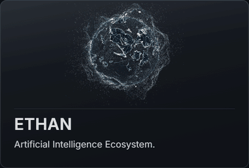

<!-- Generated by python scripts/build.py. Edit config/ and scripts/. -->

<picture><source media="(prefers-reduced-motion: reduce) and (max-width: 600px)" srcset="./generated/adaptive/hero-mobile-static.svg"><source media="(prefers-reduced-motion: reduce)" srcset="./generated/adaptive/hero-static.svg"><source media="(max-width: 600px)" srcset="./generated/adaptive/hero-mobile.svg"><source media="(prefers-color-scheme: dark)" srcset="./generated/dark/hero.svg"><source media="(prefers-color-scheme: light)" srcset="./generated/light/hero.svg"></picture>

<picture><source media="(prefers-reduced-motion: reduce) and (max-width: 600px)" srcset="./generated/adaptive/activity-mobile-static.svg"><source media="(prefers-reduced-motion: reduce)" srcset="./generated/adaptive/activity-static.svg"><source media="(max-width: 600px)" srcset="./generated/adaptive/activity-mobile.svg"><source media="(prefers-color-scheme: dark)" srcset="./generated/dark/activity.svg"><source media="(prefers-color-scheme: light)" srcset="./generated/light/activity.svg"></picture>

<picture><source media="(prefers-reduced-motion: reduce) and (max-width: 600px)" srcset="./generated/adaptive/ecosystem-header-mobile-static.svg"><source media="(prefers-reduced-motion: reduce)" srcset="./generated/adaptive/ecosystem-header-static.svg"><source media="(max-width: 600px)" srcset="./generated/adaptive/ecosystem-header-mobile.svg"><source media="(prefers-color-scheme: dark)" srcset="./generated/dark/ecosystem-header.svg"><source media="(prefers-color-scheme: light)" srcset="./generated/light/ecosystem-header.svg"></picture>

<picture><source media="(prefers-reduced-motion: reduce) and (max-width: 600px)" srcset="./generated/adaptive/project-ethan-mobile-static.svg"><source media="(prefers-reduced-motion: reduce)" srcset="./generated/adaptive/project-ethan-static.svg"><source media="(max-width: 600px)" type="image/webp" srcset="./generated/adaptive/project-ethan-mobile-webp.svg"><source media="(max-width: 600px)" srcset="./generated/adaptive/project-ethan-mobile-gif.svg"><source media="(prefers-color-scheme: dark)" type="image/webp" srcset="./generated/dark/project-ethan.webp"><source media="(prefers-color-scheme: dark)" srcset="./generated/dark/project-ethan.gif"><source media="(prefers-color-scheme: light)" type="image/webp" srcset="./generated/light/project-ethan.webp"><source media="(prefers-color-scheme: light)" srcset="./generated/light/project-ethan.gif"></picture>
<picture><source media="(prefers-reduced-motion: reduce) and (max-width: 600px)" srcset="./generated/adaptive/project-vorcen-mobile-static.svg"><source media="(prefers-reduced-motion: reduce)" srcset="./generated/adaptive/project-vorcen-static.svg"><source media="(max-width: 600px)" srcset="./generated/adaptive/project-vorcen-mobile.svg"><source media="(prefers-color-scheme: dark)" srcset="./generated/dark/project-vorcen.svg"><source media="(prefers-color-scheme: light)" srcset="./generated/light/project-vorcen.svg"></picture>

<picture><source media="(prefers-reduced-motion: reduce) and (max-width: 600px)" srcset="./generated/adaptive/project-gidace-mobile-static.svg"><source media="(prefers-reduced-motion: reduce)" srcset="./generated/adaptive/project-gidace-static.svg"><source media="(max-width: 600px)" srcset="./generated/adaptive/project-gidace-mobile.svg"><source media="(prefers-color-scheme: dark)" srcset="./generated/dark/project-gidace.svg"><source media="(prefers-color-scheme: light)" srcset="./generated/light/project-gidace.svg"></picture>
<picture><source media="(prefers-reduced-motion: reduce) and (max-width: 600px)" srcset="./generated/adaptive/project-inoryx-mobile-static.svg"><source media="(prefers-reduced-motion: reduce)" srcset="./generated/adaptive/project-inoryx-static.svg"><source media="(max-width: 600px)" srcset="./generated/adaptive/project-inoryx-mobile.svg"><source media="(prefers-color-scheme: dark)" srcset="./generated/dark/project-inoryx.svg"><source media="(prefers-color-scheme: light)" srcset="./generated/light/project-inoryx.svg"></picture>
<picture><source media="(prefers-reduced-motion: reduce) and (max-width: 600px)" srcset="./generated/adaptive/project-vaultify-mobile-static.svg"><source media="(prefers-reduced-motion: reduce)" srcset="./generated/adaptive/project-vaultify-static.svg"><source media="(max-width: 600px)" srcset="./generated/adaptive/project-vaultify-mobile.svg"><source media="(prefers-color-scheme: dark)" srcset="./generated/dark/project-vaultify.svg"><source media="(prefers-color-scheme: light)" srcset="./generated/light/project-vaultify.svg"></picture>

<picture><source media="(prefers-reduced-motion: reduce) and (max-width: 600px)" srcset="./generated/adaptive/stack-mobile-static.svg"><source media="(prefers-reduced-motion: reduce)" srcset="./generated/adaptive/stack-static.svg"><source media="(max-width: 600px)" srcset="./generated/adaptive/stack-mobile.svg"><source media="(prefers-color-scheme: dark)" srcset="./generated/dark/stack.svg"><source media="(prefers-color-scheme: light)" srcset="./generated/light/stack.svg"></picture>

<picture><source media="(prefers-reduced-motion: reduce) and (max-width: 600px)" srcset="./generated/adaptive/connections-header-mobile-static.svg"><source media="(prefers-reduced-motion: reduce)" srcset="./generated/adaptive/connections-header-static.svg"><source media="(max-width: 600px)" srcset="./generated/adaptive/connections-header-mobile.svg"><source media="(prefers-color-scheme: dark)" srcset="./generated/dark/connections-header.svg"><source media="(prefers-color-scheme: light)" srcset="./generated/light/connections-header.svg"></picture>

<a href="https://www.linkedin.com/in/lukas-alexandre-rosa/"><picture><source media="(prefers-reduced-motion: reduce)" srcset="./generated/adaptive/connection-linkedin-static.svg"><source media="(prefers-color-scheme: dark)" srcset="./generated/dark/connection-linkedin.svg"><source media="(prefers-color-scheme: light)" srcset="./generated/light/connection-linkedin.svg"></picture></a>
<a href="https://github.com/LukasAlexandre"><picture><source media="(prefers-reduced-motion: reduce)" srcset="./generated/adaptive/connection-github-static.svg"><source media="(prefers-color-scheme: dark)" srcset="./generated/dark/connection-github.svg"><source media="(prefers-color-scheme: light)" srcset="./generated/light/connection-github.svg"></picture></a>

<a href="https://lktechnologiesbrasil.com/"><picture><source media="(prefers-reduced-motion: reduce)" srcset="./generated/adaptive/connection-website-static.svg"><source media="(prefers-color-scheme: dark)" srcset="./generated/dark/connection-website.svg"><source media="(prefers-color-scheme: light)" srcset="./generated/light/connection-website.svg"></picture></a>
<a href="https://lktechnologiesbrasil.com/"><picture><source media="(prefers-reduced-motion: reduce)" srcset="./generated/adaptive/connection-company-static.svg"><source media="(prefers-color-scheme: dark)" srcset="./generated/dark/connection-company.svg"><source media="(prefers-color-scheme: light)" srcset="./generated/light/connection-company.svg"></picture></a>

<picture><source media="(prefers-reduced-motion: reduce) and (max-width: 600px)" srcset="./generated/adaptive/footer-mobile-static.svg"><source media="(prefers-reduced-motion: reduce)" srcset="./generated/adaptive/footer-static.svg"><source media="(max-width: 600px)" srcset="./generated/adaptive/footer-mobile.svg"><source media="(prefers-color-scheme: dark)" srcset="./generated/dark/footer.svg"><source media="(prefers-color-scheme: light)" srcset="./generated/light/footer.svg"></picture>
